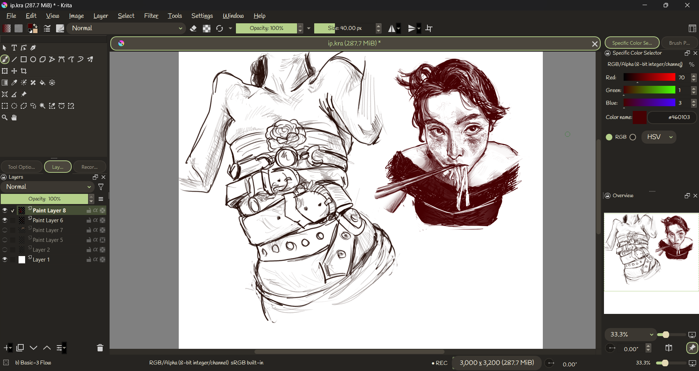
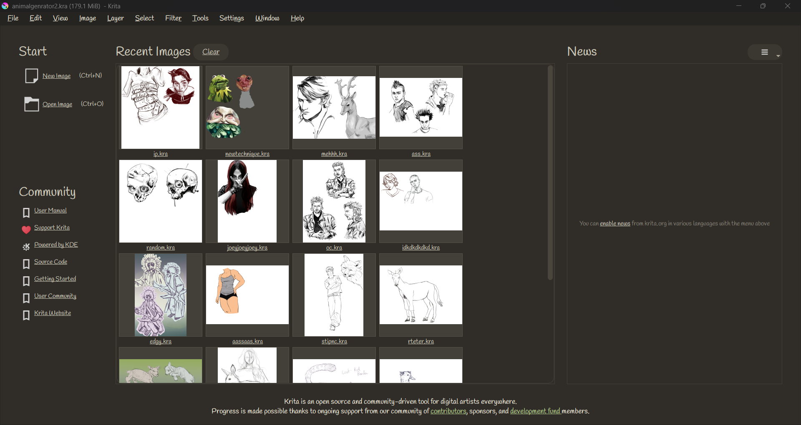

# 🍵 Matcha Latte Bubbles — a cute rounded dark UI for Krita

A dark, cozy **matcha latte** look for Krita: warm charcoal-brown panels, soft green highlights, no pink,
and everything that can be round is round (buttons, tabs, inputs, menus, tooltips, scrollbars, checkboxes).
Uses a handwriting-style font that stays readable.

**Tested on Krita 5.2.13** (Windows). Other 5.x versions should mostly work but are untested.

## Install

1. Download `matcha_bubbles.zip` from the [Releases](../../releases) page.
2. In Krita: **Tools → Scripts → Import Python Plugin from File…** and pick the zip.
3. **Settings → Configure Krita → Python Plugin Manager**, tick **Matcha Bubbles**, restart Krita.
4. *(Optional, matches the base colors)* **Settings → Manage Resources → Open Resource Folder**, create a
   `color-schemes` folder if there isn't one, drop `MatchaLatteBubbles.colors` in it, restart,
   then pick **Matcha Latte Bubbles** in **Settings → Themes**.

## Tweak it

Edit `matcha_bubbles/style.qss`, then run **Tools → Scripts → Matcha Bubbles: Reload Style**
(no restart needed). To switch it off for the session: **Tools → Scripts → Matcha Bubbles: Turn Off**.
To remove it for good, untick it in the Python Plugin Manager.

Heads-up when editing radii: Qt turns a corner **square** if its `border-radius` is bigger than half the widget's
height, so keep radii small enough (the stylesheet uses `min-height` to guarantee this).

## Known limits

Krita paints a few things itself, so a stylesheet can't round them:
the Opacity/Size sliders, docker title bars ("Layers", "Overview") and the start-page thumbnails.
The `.qss` can restyle widgets only, it can't move the layout or swap icons.

## Credits & licenses

- Plugin code and stylesheet: MIT, see [LICENSE](LICENSE).
- Includes **Handlee** by Admix Designs and **Matcha Hand** (a slightly bolder, renamed copy of Handlee),
  both under the SIL Open Font License 1.1, see `matcha_bubbles/fonts/Handlee-LICENSE.txt`.

Made with a lot of iterating and screenshots. Issues and tweaks welcome!
